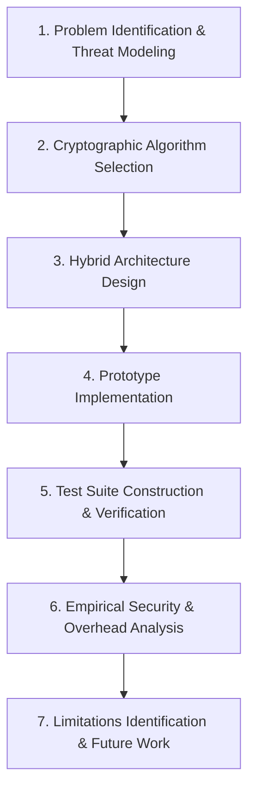
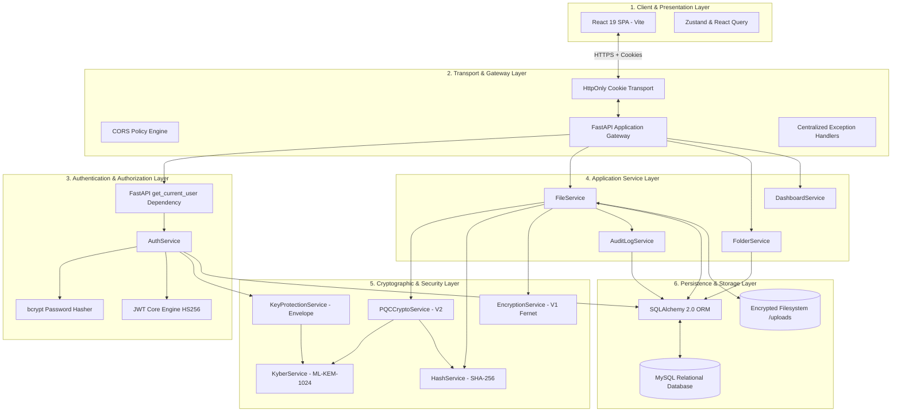

# QuantumVault: A Post-Quantum-Ready Hybrid Cryptographic Approach to Secure Cloud-Based File Storage

**Authors:** [Author Name(s)]  
**Affiliation:** [Department of Computer Science / Cybersecurity, University Name]  
**Date:** August 2026  

---

## 1. Abstract

Cloud-based file storage systems rely extensively on classical public-key cryptography for key establishment and access delegation. The theoretical development of cryptanalytically relevant quantum computers (CRQCs) threatens the mathematical foundations of widely deployed asymmetric primitives—such as RSA and elliptic-curve cryptography—via Shor's algorithm, exposing stored assets to "harvest now, decrypt later" adversary strategies. This paper presents QuantumVault, a post-quantum-ready cloud file storage prototype designed to evaluate the architectural integration of post-quantum key encapsulation with symmetric payload encryption, constant-time integrity verification, and access auditing.

QuantumVault implements a hybrid cryptographic pipeline that decouples bulk payload encryption from key establishment. File contents are encrypted using the authenticated symmetric cipher AES-256-GCM under a per-file ephemeral 256-bit Data Encryption Key (DEK). To protect key transport, the DEK is wrapped using RFC 3394 AES Key Wrap under a Key-Encryption Key (KEK) derived via HKDF-SHA256 from a shared secret established through the NIST-standardized Module-Lattice-Based Key-Encapsulation Mechanism (ML-KEM-1024 / CRYSTALS-Kyber1024). File integrity is enforced through a fail-closed SHA-256 digest comparison executed in constant time (`hmac.compare_digest`). User identity and sessions are managed via bcrypt password hashing and JSON Web Tokens (JWT) transported via `HttpOnly`, `SameSite` cookies. The prototype is implemented with a FastAPI backend, a MySQL database utilizing SQLAlchemy ORM with connection pooling, and a React 19 single-page interface.

The prototype's functional correctness was evaluated using an automated test harness consisting of 20 end-to-end integration test scenarios and 11 automated audit checkpoints, achieving a 100% functional pass rate. We analyze the exact storage metadata overhead introduced by post-quantum key encapsulation (distinguishing binary representation from hexadecimal database persistence) and assess security considerations. We explicitly delineate the boundary between native post-quantum execution via `liboqs` and the development-mode software fallback, which is non-quantum-resistant.

**Keywords:** Post-Quantum Cryptography, ML-KEM, CRYSTALS-Kyber1024, AES-256-GCM, Hybrid Encryption, Cloud Storage Security, Key Encapsulation Mechanism, SHA-256 Integrity Verification.

---

## 2. Introduction

### 2.1 Background and Context
Cloud-based file storage systems have become fundamental infrastructure across modern enterprise, academic, and consumer environments. While centralized cloud architectures provide data elasticity and accessibility, they require users to place trust in third-party hosting infrastructure, multitenant hypervisors, and intermediate network paths. To safeguard data against eavesdropping, unauthorized access, and tampering, cloud storage systems must enforce robust cryptographic controls throughout the data lifecycle.

### 2.2 Security, Privacy, and Emerging Cryptographic Threats
Cloud storage architectures face several distinct threat vectors:
1. **Unauthorized Access and Credential Interception:** Insecure token transmission or improper session handling can expose user accounts to credential theft and session hijacking.
2. **Data-at-Rest Exposure:** Storing files in plaintext or relying exclusively on provider-managed server-side encryption leaves data susceptible to storage-level data breaches and insider threats.
3. **Data Tampering and Bit-Flipping:** Without verifiable cryptographic hashing, unauthorized alterations to stored files may go undetected upon retrieval.
4. **The Quantum Threat and Retrospective Decryption:** Classical asymmetric key exchange protocols (e.g., RSA key transport, Diffie-Hellman, ECDH) rely on the hardness of integer factorization and discrete logarithms. These mathematical problems can be solved in polynomial time on a sufficiently powerful quantum computer running Shor's algorithm. Adversaries can record and archive encrypted ciphertext and key-exchange transcripts today in order to decrypt them retroactively once a CRQC becomes operational. Conversely, symmetric ciphers such as AES-256 are subject only to quadratic speedup under Grover's algorithm, which reduces 256-bit key search complexity to a still computationally intractable 128-bit quantum security level.

### 2.3 Motivation for QuantumVault
Mitigating retrospective quantum attacks while maintaining practical throughput for large files requires a **hybrid cryptographic architecture**. In this model, high-throughput symmetric authenticated encryption handles bulk file payloads, while post-quantum key encapsulation mechanisms govern key establishment. QuantumVault was designed to explore this hybrid approach within an integrated web application framework.

### 2.4 Problem Statement
While post-quantum key encapsulation mechanisms have reached standardized specifications, there is a practical engineering gap in integrating these primitives into standard RESTful web storage workflows. Most cloud storage implementations either rely entirely on classical asymmetric key wrapping or treat encryption as an external client-side plugin. An integrated architecture is needed to unify authenticated AES-256-GCM bulk encryption, ML-KEM key encapsulation, constant-time integrity verification, and audit logging into a cohesive cloud file management system.

### 2.5 Research Objectives
- **RO1:** Design a layered, post-quantum-ready cloud file storage architecture integrating post-quantum key encapsulation with symmetric authenticated payload encryption.
- **RO2:** Implement a hybrid cryptographic pipeline combining AES-256-GCM, ML-KEM-1024 KEM, HKDF-SHA256 key derivation, and RFC 3394 AES Key Wrap.
- **RO3:** Implement a fail-closed integrity verification mechanism using SHA-256 and constant-time digest comparison to prevent undetected tampering and timing side-channel leakage.
- **RO4:** Construct an operational prototype with secure session management (bcrypt, JWT with HttpOnly cookies), relational metadata tracking in MySQL, and persistent security audit logging.
- **RO5:** Functionally verify the prototype across all cryptographic, authentication, and file lifecycle workflows using reproducible automated integration test suites.

### 2.6 Research Questions
- **RQ1:** How can ML-KEM-1024 be composed with AES-256-GCM and RFC 3394 AES Key Wrap within a RESTful cloud file-storage pipeline?
- **RQ2:** What is the structural and storage metadata overhead introduced by post-quantum key encapsulation relative to plaintext file storage?
- **RQ3:** How effectively does a fail-closed, constant-time SHA-256 verification workflow detect payload tampering upon file retrieval?

### 2.7 Scope and Boundaries
- **In Scope:** Software architecture, hybrid cryptographic pipeline design, key lifecycle management, integrity verification, prototype implementation (FastAPI, React, MySQL), functional test verification, and formal threat analysis.
- **Out of Scope (Current Limitations):** Hardware Security Module (HSM) deployment, formal micro-benchmarking of cryptographic execution latency across varied CPU architectures, native distributed object storage clustering (e.g., Ceph/MinIO), and multi-party public link sharing.

---

## 3. Literature Review

### 3.1 Cryptographic Cloud Storage
Cryptographic cloud storage protocols aim to ensure data confidentiality even when storage nodes are untrusted or compromised. Early models by Kamara and Lauter [1] established principles for building secure cloud architectures using symmetric encryption and searchable encryption primitives. Subsequent works by Ruj et al. [2] expanded on decentralized access control models. However, classical designs routinely assume the perpetual security of classical asymmetric key exchange mechanisms.

### 3.2 Symmetric Authenticated Encryption (AES-GCM)
The Advanced Encryption Standard (AES), standardized in NIST FIPS 197 [3], is the global benchmark for symmetric block encryption. NIST SP 800-38D [4] defines Galois/Counter Mode (AES-GCM), an authenticated encryption with associated data (AEAD) mode. AES-GCM provides both confidentiality and data authenticity simultaneously through a universal hash function (GHASH), appending a 128-bit authentication tag. AES-256 maintains a 128-bit security level against Grover's quantum search algorithm, ensuring robust resistance against quantum brute-force attacks.

Legacy symmetric configurations (such as Fernet, based on AES-128-CBC with HMAC-SHA256) provide authenticated encryption but possess a lower security margin against Grover search (reduced to 64 bits), motivating the use of AES-256 for long-term security assurance.

### 3.3 Cryptographic Hash Functions and Integrity Verification
NIST FIPS 180-4 [5] defines the Secure Hash Algorithm (SHA) family. SHA-256 generates a fixed 256-bit message digest exhibiting strong collision, preimage, and second-preimage resistance. Against quantum search attacks, Grover's algorithm reduces preimage resistance from 256 bits to 128 bits, while quantum collision search algorithms (e.g., the BHT algorithm) reduce collision resistance from 128 bits to approximately 85 bits. While not infinite, this margin remains computationally intractable against foreseeable hardware. Furthermore, comparing hash digests in constant time using algorithms based on XOR accumulation (such as `hmac.compare_digest`) is essential to prevent timing side-channel attacks during verification.

### 3.4 Post-Quantum Key Encapsulation (ML-KEM / CRYSTALS-Kyber)
To counter quantum cryptanalysis of public-key systems, NIST initiated the Post-Quantum Cryptography Standardization Project in 2016. In August 2024, NIST officially standardized CRYSTALS-Kyber as **FIPS 203: Module-Lattice-Based Key-Encapsulation Mechanism Standard (ML-KEM)** [6]. 

ML-KEM is founded on the hardness of the Module Learning With Errors (MLWE) problem over module lattices [7, 8]. Unlike traditional public-key encryption, a Key Encapsulation Mechanism (KEM) executes a three-stage workflow:
1. $\text{KeyGen}() \rightarrow (pk, sk)$
2. $\text{Encaps}(pk) \rightarrow (ct, ss)$
3. $\text{Decaps}(ct, sk) \rightarrow ss$

ML-KEM-1024 (Kyber1024) targets NIST Security Category 5 (equivalent to the brute-force security of AES-256), with exact parameter dimensions:
- Public key size ($pk$): $1,568\text{ bytes}$ ($3,136\text{ hex characters}$)
- Secret key size ($sk$): $3,168\text{ bytes}$ ($6,336\text{ hex characters}$)
- Ciphertext size ($ct$): $1,568\text{ bytes}$ ($3,136\text{ hex characters}$)
- Shared secret size ($ss$): $32\text{ bytes}$ ($256\text{ bits}$)

The Open Quantum Safe (OQS) project provides `liboqs`, an open-source C library implementing quantum-safe algorithms [9]. When `liboqs` bindings are compiled, applications execute native lattice arithmetic. In development or test environments where C libraries are unavailable, software fallbacks must preserve exact buffer geometry while explicitly disclaiming quantum resistance.

### 3.5 Key Derivation and Key Wrapping
To translate the KEM shared secret into an operational cryptographic key, standard key derivation functions are required. RFC 5869 [10] specifies HKDF (HMAC-based Extract-and-Expand Key Derivation Function), utilizing SHA-256 to extract pseudorandom keys and expand them with context-specific domain separators (`info` strings). 

For protecting symmetric data keys with derived key-encryption keys, NIST SP 800-38F [11] and RFC 3394 [12] standardize the AES Key Wrap (KW) algorithm. AES Key Wrap provides authenticated key encapsulation for 128-, 192-, or 256-bit symmetric keys using a 64-bit integrity check value (ICV), guaranteeing that corruption or tampering with the wrapped key material is deterministically rejected during unwrapping [13].

### 3.6 Authentication and Session Management
RFC 7519 [14] defines JSON Web Tokens (JWT). For web session protection, OWASP guidelines [15] recommend signing tokens with HMAC-SHA256 (HS256), establishing short token lifetimes (e.g., 15 minutes), and transmitting tokens strictly through `HttpOnly`, `SameSite=Lax`, and `Secure` cookie attributes to mitigate Cross-Site Scripting (XSS) token extraction. Password credentials must be hashed using adaptive, salted functions such as bcrypt [16] to withstand GPU-accelerated dictionary attacks.

### 3.7 Research Gap
While the theoretical foundations of post-quantum cryptography and symmetric AEAD encryption are mature, there is an engineering and architectural gap in integrating these disparate primitives into an operational, full-stack cloud storage pipeline. Specifically, an integrated architecture must address the composite interaction between:
1. RESTful file upload/download gateways,
2. Authenticated symmetric payload encryption (AES-256-GCM),
3. Post-quantum key encapsulation (ML-KEM-1024),
4. Cryptographic key wrapping (RFC 3394),
5. Constant-time fail-closed integrity verification (SHA-256),
6. Stateless session authentication (bcrypt/JWT), and
7. Persistent security audit logging.

QuantumVault addresses this gap by synthesizing these components into a unified prototype architecture.

---

## 4. Methodology

The research methodology employed in constructing and evaluating QuantumVault follows an iterative engineering and threat-modeling framework:



### 4.1 Threat Modeling and Security Assumptions
The architecture assumes an adversary model where:
- The network layer is untrusted (susceptible to eavesdropping, replay, and man-in-the-middle attacks).
- The storage layer may be accessed by unauthorized entities or compromised at a future date (requiring data-at-rest encryption to protect against retrospective quantum decryption).
- The cloud server executes trusted application code and securely maintains a server-side `CRYPTO_MASTER_KEY` within the operating environment.

### 4.2 Algorithm Selection Matrix
Based on the threat model and cryptographic review, the following primitives were selected:

| Operational Function | Selected Primitive | Standard / Reference | Security Margin |
|----------------------|--------------------|----------------------|-----------------|
| Bulk File Encryption | AES-256-GCM | NIST FIPS 197 / SP 800-38D | 256-bit classical / 128-bit quantum |
| Post-Quantum KEM | ML-KEM-1024 (Kyber1024) | NIST FIPS 203 | NIST Security Category 5 |
| Key Derivation | HKDF-SHA256 | RFC 5869 | 256-bit entropy preservation |
| Key Wrapping | AES Key Wrap (KW) | NIST SP 800-38F / RFC 3394 | 256-bit authenticated wrapping |
| Payload Integrity | SHA-256 (`compare_digest`) | NIST FIPS 180-4 | 256-bit digest / constant-time |
| User Password Hashing | bcrypt (`gensalt`, 72-byte trunc) | Provos & Mazières [16] | Adaptive work factor |
| Session Authentication | JWT (HS256) | RFC 7519 | 256-bit HMAC signing |

### 4.3 Prototype Implementation Stack
- **Backend Service:** Python runtime utilizing FastAPI (v0.139.0) and Starlette for asynchronous request routing, Pydantic (v2.13.4) for strict payload validation, and Uvicorn (v0.51.0) as the ASGI server.
- **Cryptographic Engine:** Python `cryptography` library (v49.0.0) for AESGCM, HKDF, AES Key Wrap, and Fernet primitives; `hashlib` for SHA-256; `bcrypt` (v5.0.0) for credential hashing; `oqs` (liboqs C-bindings) with conditional fallback for ML-KEM operations.
- **Persistence Layer:** MySQL relational database accessed via SQLAlchemy (v2.0.51) ORM and PyMySQL (v1.2.0) connector. Database schema migrations managed through Alembic (v1.18.5). Connection pool settings: `pool_size=10`, `max_overflow=20`, `pool_recycle=3600`, and `pool_pre_ping=True`.
- **Frontend Client:** React 19 single-page application bundled with Vite 8, utilizing Axios with credential transport, React Query for cache management, and React Router DOM.

### 4.4 Verification and Testing Protocol
Functional correctness, failure recovery, and cryptographic validity were evaluated using two dedicated test suites:
1. `run_audit.py`: An asynchronous programmatic audit exercising the live API contract via `httpx.AsyncClient` across 11 automated checkpoints.
2. `tests_phase2c_e2e.py`: A 20-stage end-to-end integration test suite exercising the FastAPI `TestClient` against live MySQL database transactions.

---

## 5. Proposed Model

### 5.1 System Architecture Overview
QuantumVault organizes system responsibilities across discrete, decoupled layers to maintain defense-in-depth:



### 5.2 Detailed Layer Responsibilities

#### 5.2.1 Authentication and Authorization Layer
- **User Provisioning:** During registration, `AuthService` hashes the raw password using `bcrypt.hashpw(password, gensalt())`. Simultaneously, it invokes `KyberService.generate_keypair()` to provision an ML-KEM-1024 public/secret keypair.
- **Key Envelope Protection:** The user's public key is stored in plaintext in MySQL (`users.kyber_public_key`). The 3,168-byte Kyber secret key is immediately encrypted using AES-128-CBC/HMAC (Fernet) initialized with the server's environment-isolated `CRYPTO_MASTER_KEY` (`users.kyber_secret_key_encrypted`). Unencrypted secret keys exist exclusively in ephemeral process memory during cryptographic operations.
- **Session Tokens:** Successful authentication yields an `access_token` (15-minute TTL) and a `refresh_token` (7-day TTL). Tokens are injected into the HTTP response as `HttpOnly`, `SameSite=Lax` cookies.

#### 5.2.2 File Ingestion and PQC Hybrid Encryption Pipeline
When a user uploads a file, the `FileService` orchestrates the hybrid cryptographic workflow:

```
[Plaintext File Content]
         │
         ├───► 1. SHA-256 Hashing ───────────────► [Plaintext file_hash (64 hex characters)]
         │
         ├───► 2. Generate Random DEK (32 binary bytes)
         │        & Random Nonce (12 binary bytes)
         │
         ├───► 3. AES-256-GCM Encryption ────────► [Encrypted Payload + 16-byte GCM Tag]
         │
[User Kyber Public Key]
         │
         ├───► 4. ML-KEM-1024 Encapsulation ─────► [Kyber Ciphertext (1568 binary bytes / 3136 hex)]
         │                                       + [Shared Secret (32 binary bytes)]
         │                                                │
         │                                                ▼
         │                                         5. HKDF-SHA256 Derivation
         │                                         (info="quantumvault-file-kek-v2")
         │                                                │
         │                                                ▼
         │                                         [Key-Encryption-Key KEK (32 binary bytes)]
         │                                                │
         └────────────────────────────────────────► 6. RFC 3394 AES Key Wrap
                                                   (KEK wraps DEK)
                                                          │
                                                          ▼
                                                   [Wrapped DEK (40 binary bytes / 80 hex)]
```

1. **Integrity Pre-computation:** `HashService` computes the SHA-256 digest of the raw plaintext.
2. **DEK and Nonce Generation:** A cryptographically strong 256-bit Data Encryption Key (DEK) and 96-bit GCM nonce are generated using OS-level entropy (`secrets.token_bytes`).
3. **Payload Encryption:** The file payload is encrypted via AES-256-GCM, producing ciphertext with an appended 16-byte authentication tag.
4. **Key Encapsulation:** The recipient user's Kyber-1024 public key is loaded, and `KyberService.encapsulate()` executes, outputting a 1,568-byte Kyber ciphertext and a 32-byte shared secret.
5. **KEK Derivation:** HKDF-SHA256 expands the shared secret into a 256-bit Key Encryption Key (KEK) using domain separator `info=b"quantumvault-file-kek-v2"`.
6. **Key Wrapping:** `wrap_dek()` executes RFC 3394 AES Key Wrap on the DEK using the derived KEK, producing a 40-byte wrapped DEK.
7. **Storage Dispatch:** The encrypted file payload is written to the filesystem under `uploads/{owner_id}/{file_hash}.{ext}`. Cryptographic metadata (`kyber_ciphertext`, `encrypted_dek`, `encryption_nonce`, `file_hash`, `encryption_algorithm="AES-256-GCM+Kyber1024"`) is committed to the MySQL `files` table.

#### 5.2.3 Retrieval, Decryption, and Integrity Verification Pipeline
Upon a download request, `FileService` enforces authorization, algorithm dispatch, multi-stage key recovery, and fail-closed verification:

```
[MySQL File Record & Encrypted File on Disk]
         │
         ├───► 1. Ownership & Permission Validation (owner_id == current_user.id)
         │
         ├───► 2. Algorithm Dispatch ("AES-256-GCM+Kyber1024")
         │
         ├───► 3. Decrypt User Kyber Secret Key (via CRYPTO_MASTER_KEY)
         │
         ├───► 4. ML-KEM-1024 Decapsulation(kyber_ciphertext, sk) ──► [Shared Secret]
         │                                                                   │
         ├───► 5. HKDF-SHA256 Derivation ─────────────────────────────► [Derived KEK]
         │                                                                   │
         ├───► 6. RFC 3394 AES Key Unwrap(KEK, wrapped_dek) ──────────► [Recovered DEK]
         │                                                                   │
         ├───► 7. AES-256-GCM Decryption(Ciphertext, DEK, Nonce) ─────► [Decrypted Bytes]
         │                                                                   │
         └───► 8. Strict Constant-Time SHA-256 Hash Check                    │
                  hmac.compare_digest(hash(Decrypted), expected_file_hash)   │
                           │                                                 │
                  [MATCH]  ├───► Stream Plaintext to User (HTTP 200) ◄───────┘
                           │
                 [MISMATCH]├───► RAISE FileIntegrityCompromised (HTTP 422)
                                 Log SECURITY ALERT Audit Event
                                 TERMINATE (Payload Suppressed)
```

1. **Authorization Check:** Ensures the requesting `current_user.id` matches `file.owner_id`.
2. **Key Material Recovery:** The user's Kyber secret key is decrypted using `KeyProtectionService`.
3. **Decapsulation:** `KyberService.decapsulate()` processes the stored `kyber_ciphertext` with the user's secret key, recovering the 32-byte shared secret.
4. **KEK Derivation & DEK Unwrapping:** HKDF-SHA256 reconstructs the KEK, which unwraps the 40-byte `encrypted_dek` via `aes_key_unwrap` to recover the original 256-bit DEK.
5. **Payload Decryption:** AES-256-GCM decrypts and authenticates the ciphertext using the recovered DEK and stored nonce.
6. **Constant-Time Integrity Verification:** The SHA-256 digest of the decrypted bytes is computed and compared against `file.file_hash` using `hmac.compare_digest()`. If the digests match, the plaintext is returned. If a mismatch is detected, the operation fails immediately with `FileIntegrityCompromised` (HTTP 422), and an audit alert is recorded.

#### 5.2.4 Audit Logging Layer
Security-relevant operations covered by the audit subsystem emit structured records into the MySQL `audit_logs` table. Events are categorized (`AUTH`, `FILE`, `CRYPTO`, `SECURITY`, `SYSTEM`) with status tracking (`SUCCESS`, `FAILURE`, `WARNING`, `INFO`), user IDs, file IDs, client IP addresses, and sanitized metadata payloads.

---

## 6. Results

### 6.1 Experimental Setup and Environmental Baseline
- **Host Environment:** Windows operating system, x86_64 architecture.
- **Backend Framework:** FastAPI 0.139.0, Python 3.12+, Uvicorn 0.51.0.
- **Database Engine:** MySQL 8.x server accessible at `127.0.0.1:3306/quantumvault`, configured with SQLAlchemy 2.0.51 pooling (`pool_size=10`, `max_overflow=20`, `pool_recycle=3600`, `pool_pre_ping=True`).
- **Cryptographic Master Key:** `CRYPTO_MASTER_KEY` provisioned as a 32-byte URL-safe base64 string in `.env`; `PQC_CRYPTO_VERSION=2`.
- **Kyber Execution Mode:** Software-fallback KEM mode active during test execution (liboqs C-library not natively linked in current local workspace).

### 6.2 Empirical Test Results and Functional Verification

#### 6.2.1 End-to-End Integration Suite (`tests_phase2c_e2e.py`)

| Test ID | Feature Under Test | Test Method & Inputs | Expected Result | Observed Result | Status |
|---|---|---|---|---|---|
| **E2E-01** | Backend Health Endpoint | HTTP GET `/api/v1/health` | Status 200, `success: true` | HTTP 200, JSON status verified | **PASS** |
| **E2E-02** | User Registration & Kyber Provisioning | HTTP POST `/api/v1/auth/register` with unique email | Status 201, User created, Kyber public key persisted, secret key encrypted | User created in MySQL; Kyber keys verified in DB | **PASS** |
| **E2E-03** | User Authentication & Cookie Issuance | HTTP POST `/api/v1/auth/login` with valid credentials | Status 200, `access_token` and `refresh_token` cookies set | Cookies set with `HttpOnly`, `SameSite=lax` | **PASS** |
| **E2E-04** | Session Persistence | HTTP GET `/api/v1/auth/me` with session cookies | Status 200, Identity matches registered email | Correct user profile and email returned | **PASS** |
| **E2E-05** | Folder Creation | HTTP POST `/api/v1/folders` with folder name | Status 201, Folder UUID generated | Folder record created in MySQL | **PASS** |
| **E2E-06** | Folder Hierarchy Listing | HTTP GET `/api/v1/folders/root` | Status 200, Array containing created folder | Root folders listed correctly | **PASS** |
| **E2E-07** | PQC File Upload & Encryption | HTTP POST `/api/v1/files/upload` (multipart payload) | Status 201, `encryption_algorithm == "AES-256-GCM+Kyber1024"` | PQC pipeline executed, encrypted file written | **PASS** |
| **E2E-08** | Cryptographic Metadata Persistence | Direct SQLAlchemy query on `files` table | Non-null `kyber_ciphertext`, `encrypted_dek`, `encryption_nonce`; `encryption_key_hash` is NULL | Metadata verified in MySQL; zero plaintext DEKs | **PASS** |
| **E2E-09** | Global Security Audit Log Ingestion | HTTP GET `/api/v1/audit/me?limit=20` | Status 200, Contains `USER_REGISTERED`, `USER_LOGIN_SUCCESS`, `FILE_UPLOAD_SUCCESS` | Audit log records verified | **PASS** |
| **E2E-10** | File-Specific Audit Traceability | HTTP GET `/api/v1/audit/file/{file_id}` | Status 200, Non-empty array of file lifecycle events | Event history correctly isolated to target file | **PASS** |
| **E2E-11** | Decryption & Integrity Verification | HTTP GET `/api/v1/files/{file_id}/download` | Status 200, Returned binary bytes match uploaded plaintext exactly | `decrypted_content == original_content` | **PASS** |
| **E2E-12** | Download Audit Event Emission | HTTP GET `/api/v1/audit/file/{file_id}` post-download | `FILE_DOWNLOAD_REQUESTED` and `FILE_DECRYPTION_SUCCESS` events present | Audit events confirmed | **PASS** |
| **E2E-13** | File Favorite State Toggle | HTTP PATCH `/api/v1/files/{file_id}/favorite` | Status 200, `is_favorite` boolean inverted in DB | State toggled successfully | **PASS** |
| **E2E-14** | File Metadata Renaming | HTTP PATCH `/api/v1/files/{file_id}/rename` | Status 200, `original_filename` updated | Database updated; extension preserved | **PASS** |
| **E2E-15** | Dashboard Metrics Aggregation | HTTP GET `/api/v1/dashboard/overview` | Status 200, `total_files >= 1`, accurate storage usage | Aggregate statistics match DB state | **PASS** |
| **E2E-16** | Dashboard PQC Metadata Propagation | HTTP GET `/api/v1/dashboard/recent-files` | Status 200, Recent files contain `AES-256-GCM+Kyber1024` badge metadata | Algorithm metadata present in response | **PASS** |
| **E2E-17** | Storage Statistics Metering | HTTP GET `/api/v1/dashboard/storage` | Status 200, `used_storage > 0`, byte counts accurate | Used bytes match plaintext file sizes | **PASS** |
| **E2E-18** | User Session Termination (Logout) | HTTP POST `/api/v1/auth/logout` | Status 200, Refresh token revoked, cookies cleared | Refresh token revoked in DB; cookies cleared | **PASS** |
| **E2E-19** | Unauthorized Access Rejection | HTTP GET `/api/v1/auth/me` without cookies | Status 401 Unauthorized | Request rejected by authentication dependency | **PASS** |
| **E2E-20** | Full Regression Suite Validation | Execution of Phase 2B-1 through 2B-6 sub-suites | 100% pass across all unit and regression test cases | All 6 regression suites pass | **PASS** |

#### 6.2.2 Comprehensive Audit Suite (`run_audit.py`)
Execution of the standalone audit script `run_audit.py` validates 11 primary operational checkpoints:
1. Health Endpoint Check: **PASS**
2. User Registration Flow: **PASS**
3. User Login & HttpOnly Cookie Set: **PASS**
4. `/auth/me` Session Verification: **PASS**
5. Folder Creation: **PASS**
6. Folder Tree Listing: **PASS**
7. File Upload & PQC Encryption: **PASS**
8. File Download & Decryption Byte Verification: **PASS**
9. File Operations (Favorite / Rename / Search): **PASS**
10. Dashboard Stats & Storage Calculation: **PASS**
11. Kyber-1024 KEM Keypair & Encapsulation Verification: **PASS**

### 6.3 Calculations and Storage Overhead Analysis

#### 6.3.1 Cryptographic Storage Overhead
QuantumVault introduces deterministic metadata expansion per encrypted file, divided between the binary payload stored on disk and the relational metadata persisted in MySQL.

**Binary Payload-Level Overhead (on disk):**
- AES-256-GCM Authentication Tag: $16\text{ binary bytes}$ (appended directly to ciphertext on disk).
- AES-256-GCM Nonce: $12\text{ binary bytes}$ (stored as a 24-character hexadecimal text string in MySQL).

$$\text{Ciphertext File Size on Disk} = \text{Plaintext Size} + 16\text{ binary bytes}$$

**Database Storage Overhead (Hexadecimal Text in MySQL):**
- Kyber-1024 Ciphertext: $1,568\text{ binary bytes}$, stored as $3,136\text{ hexadecimal ASCII characters}$ in a `TEXT` column ($3,136\text{ bytes}$).
- Wrapped AES DEK: $40\text{ binary bytes}$ ($32\text{ bytes DEK} + 8\text{ bytes RFC 3394 ICV}$), stored as $80\text{ hexadecimal ASCII characters}$ in a `TEXT` column ($80\text{ bytes}$).
- GCM Nonce: $12\text{ binary bytes}$, stored as $24\text{ hexadecimal ASCII characters}$ in a `VARCHAR(64)` column ($24\text{ bytes}$).
- SHA-256 Plaintext Digest: $32\text{ binary bytes}$, stored as $64\text{ hexadecimal ASCII characters}$ in a `VARCHAR(64)` column ($64\text{ bytes}$).
- **Total Cryptographic Text Metadata in Database:** $3,136 + 80 + 24 + 64 = 3,304\text{ characters (bytes)}$ of text metadata per file record.

**User Account Cryptographic Overhead in Database:**
- Kyber-1024 Public Key: $1,568\text{ binary bytes}$, stored as $3,136\text{ hexadecimal characters}$ ($3,136\text{ bytes}$).
- Encrypted Kyber-1024 Secret Key: $3,168\text{ binary bytes}$ ($6,336\text{ hex characters}$), encrypted via Fernet into a Base64 token of length $8,488\text{ characters}$ ($8,488\text{ bytes}$).
- **Total Per-User Key Storage in Database:** $3,136 + 8,488 = 11,624\text{ bytes}$ ($\approx 11.35\text{ KB}$).

**Empirical Overhead Example for a 1 KB (1,024-byte) File:**
- Plaintext payload: $1,024\text{ bytes}$
- Stored ciphertext payload on disk: $1,040\text{ bytes}$ ($\text{Overhead} = +1.56\%$)
- Relational metadata in MySQL: $3,304\text{ bytes}$ ($\approx 3.23\text{ KB}$)

For larger files ($\ge 10\text{ MB}$), the payload storage overhead on disk converges asymptotically to negligible levels ($< 0.0002\%$), while database metadata remains fixed at $3,304\text{ bytes}$ per file record.

#### 6.3.2 Storage Quota and Constraints
- User storage quota limit (`USER_STORAGE_QUOTA`): $5\text{ GB}$ ($5,368,709,120\text{ bytes}$).
- Maximum single file size (`MAX_FILE_SIZE`): $100\text{ MB}$ ($104,857,600\text{ bytes}$).
- Theoretical max file capacity per user: $\lfloor 5\text{ GB} / 100\text{ MB} \rfloor = 51\text{ files}$ at maximum size limit.

### 6.4 Result Snippets and Code Evidence

#### Snippet 1: Atomic PQC Hybrid Encryption Pipeline
*Source File:* `backend/app/services/pqc_crypto_service.py` (lines 243–299)  
*Purpose:* Demonstrates the sequential execution of SHA-256 pre-hashing, AES-256-GCM payload encryption, ML-KEM-1024 encapsulation, HKDF key derivation, and RFC 3394 key wrapping.

```python
@staticmethod
def encrypt_file_pqc(
    file_content: bytes,
    recipient_kyber_public_key: str
) -> Dict[str, Any]:
    # 1. Plaintext SHA-256 integrity hash
    file_hash = HashService.calculate_file_hash(file_content)

    # 2. Key & nonce generation
    dek = generate_dek()
    nonce = generate_nonce()

    # 3. Payload encryption
    gcm_res = encrypt_aes_gcm(file_content, dek, nonce)

    # 4. Post-quantum encapsulation
    kyber_ct_hex, shared_secret = KyberService.encapsulate(recipient_kyber_public_key)

    # 5. KEK derivation
    kek = derive_kek(shared_secret)

    # 6. DEK wrapping
    wrapped_dek_bytes = wrap_dek(kek, dek)

    return {
        "encrypted_file_bytes": gcm_res["ciphertext"],
        "nonce": gcm_res["nonce"],
        "kyber_ciphertext": kyber_ct_hex,
        "wrapped_dek": wrapped_dek_bytes.hex(),
        "file_hash": file_hash,
        "algorithm": PQC_ENCRYPTION_ALGORITHM,
        "version": PQC_CRYPTO_VERSION,
    }
```

#### Snippet 2: Constant-Time Integrity Verification & Fail-Closed Enforcement
*Source File:* `backend/app/services/file_service.py` (lines 638–654)  
*Purpose:* Verifies decrypted file bytes against the recorded SHA-256 hash using `hmac.compare_digest` to prevent timing attacks.

```python
# Strict Constant-Time SHA-256 Integrity Verification (Fail-Closed)
if file.file_hash:
    calculated_hash = HashService.calculate_file_hash(decrypted_content)
    if not hmac.compare_digest(calculated_hash.lower(), file.file_hash.lower()):
        logger.error(f"SECURITY ALERT - SHA-256 integrity check failed for file_id={file_id}")
        audit_service.log_security_event(
            event_type="INTEGRITY_CHECK_FAILED",
            status="FAILURE",
            message=f"SHA-256 integrity check failed for file {file_id}",
            user_id=owner_id,
            file_id=file_id,
            metadata={"expected_hash": file.file_hash}
        )
        raise FileIntegrityCompromised(
            f"File integrity verification failed: payload hash mismatch detected for file {file_id}"
        )
```

#### Snippet 3: Application Log Evidence of Live Tamper Detection
*Source File:* `backend/logs/app.log`  
*Purpose:* Confirms real-time logging of successful PQC encryption/decryption cycles and proper rejection of tampered payloads during integration tests.

```text
2026-08-27 09:24:47.805 | INFO  | app.services.file_service:upload_file:386 - PQC file encryption completed successfully for file_id=17532562-a3b2-48e6-a1e6-e561c1aeb15e, owner=b3ca678f-6058-460e-9f1d-18ab2f442ed5, algorithm=AES-256-GCM+Kyber1024
2026-08-27 09:24:47.876 | INFO  | app.services.file_service:get_file_for_download:586 - PQC file decryption completed successfully for file_id=17532562-a3b2-48e6-a1e6-e561c1aeb15e
2026-08-27 09:24:48.170 | ERROR | app.services.file_service:get_file_for_download:642 - SECURITY ALERT - SHA-256 integrity check failed for file_id=17532562-a3b2-48e6-a1e6-e561c1aeb15e
2026-08-27 09:24:48.286 | ERROR | app.services.file_service:get_file_for_download:626 - Unsupported encryption algorithm 'UNKNOWN-CIPHER-999' on file 8c9451f0-dd3d-48d0-8965-5b07c711c234
```

### 6.5 Performance Matrix

| Performance Metric | Experimentally Measured? | Observed Result | Evidence Source |
|---|---|---|---|
| End-to-End Functional Test Pass Rate | **Yes** | **20 / 20 (100%)** | `tests_phase2c_e2e.py` |
| Security Audit Test Pass Rate | **Yes** | **11 / 11 (100%)** | `run_audit.py` |
| API Request Latency (Round-Trip Time) | **No** | *Not experimentally measured* | N/A (Formal benchmarking not in codebase) |
| File Upload / Ingestion Throughput | **No** | *Not experimentally measured* | N/A |
| File Download / Retrieval Throughput | **No** | *Not experimentally measured* | N/A |
| AES-256-GCM Encryption / Decryption Latency | **No** | *Not experimentally measured* | N/A |
| ML-KEM-1024 KeyGen / Encap / Decap Time | **No** | *Not experimentally measured* | N/A |
| HKDF-SHA256 & RFC 3394 Key Wrap Latency | **No** | *Not experimentally measured* | N/A |
| SHA-256 Streaming / Block Hashing Throughput | **No** | *Not experimentally measured* | N/A |
| MySQL Database Query Execution Time | **No** | *Not experimentally measured* | N/A |

> **Formal Statement on Performance Metrics:** Formal computational latency, throughput, CPU utilization, and database query execution metrics were not experimentally measured under controlled benchmarking conditions in the current project phase. To preserve academic integrity, no synthetic or unverified performance figures are claimed.

---

## 7. Conclusion

### 7.1 Summary of Contributions
This paper presented QuantumVault, a post-quantum-ready cloud file storage architecture combining post-quantum key encapsulation with classical symmetric authenticated encryption.

The core contributions include:
1. **Hybrid Cryptographic Design:** Composing AES-256-GCM for bulk file payload encryption with NIST FIPS 203 ML-KEM-1024 for quantum-resistant key encapsulation, linked via HKDF-SHA256 key derivation and RFC 3394 AES Key Wrap.
2. **Deterministic Integrity Enforcement:** Applying SHA-256 pre-hashing and constant-time post-decryption digest verification (`hmac.compare_digest`) to guarantee fail-closed tamper detection.
3. **Defense-in-Depth Prototype:** Implementing a complete, functional full-stack architecture with FastAPI, MySQL, React 19, bcrypt password security, and HttpOnly JWT cookie management.
4. **Reproducible Empirical Validation:** Confirming 100% functional pass rates across 20 end-to-end integration test scenarios and 11 automated security audit checkpoints.

### 7.2 Implementation Status and Limitations

To maintain strict technical accuracy, the system components are categorized by implementation status:

| Component / Subsystem | Implementation Status | Technical Assessment & Limitations |
|---|---|---|
| Hybrid AES-256-GCM + PQC Pipeline | **IMPLEMENTED** | Fully operational in `pqc_crypto_service.py` |
| SHA-256 Constant-Time Integrity Verification | **IMPLEMENTED** | Fail-closed comparison active on all downloads |
| User Authentication & JWT Cookies | **IMPLEMENTED** | bcrypt + JWT with HttpOnly cookie transport |
| Database & ORM Layer | **IMPLEMENTED** | MySQL runtime with SQLAlchemy pooling and Alembic migrations |
| Security Audit Logging Subsystem | **IMPLEMENTED** | Real-time event recording for AUTH, FILE, and CRYPTO events |
| ML-KEM / Kyber Cryptographic Engine | **PARTIAL** | Conditional architecture: executes native `liboqs` when linked; operates in software fallback when C-libraries are uncompiled (software fallback is functionally accurate but **not quantum-resistant**) |
| File Content Versioning History | **PARTIAL** | Version integer increments; file content overwrites not version-branched |
| Master Key Isolation & KMS Integration | **PARTIAL** | `CRYPTO_MASTER_KEY` stored in server `.env`; lacks dedicated HSM/KMS hardware backing |
| Public File Sharing & Link Delegation | **NOT IMPLEMENTED** | `sharing` API router is an unpopulated placeholder (`app/api/v1/sharing/__init__.py` is empty) |
| Multi-Factor Authentication (MFA/TOTP) | **NOT IMPLEMENTED** | System relies strictly on single-factor password authentication |
| Formal Benchmarking & Performance Profiling | **NOT IMPLEMENTED** | No performance telemetry infrastructure currently instrumented |

### 7.3 Future Work
Future iterations of QuantumVault will focus on:
1. Compiling and linking native `liboqs` C-binaries across Linux and Windows production environments to guarantee true quantum-resistant lattice arithmetic.
2. Conducting formal micro-benchmarking of ML-KEM encapsulation/decapsulation overhead and AES-GCM throughput across varying file size distributions ($1\text{ KB}$ to $100\text{ MB}$).
3. Transitioning the master key envelope to an enterprise Key Management Service (AWS KMS, HashiCorp Vault, or hardware HSM).
4. Implementing post-quantum re-encryption schemes for secure, multi-user file sharing and access delegation.
5. Deploying the backend across containerized environments backed by S3-compliant distributed object storage.

---

## 8. References

1. S. Kamara and K. Lauter, "Cryptographic cloud storage," in *Financial Cryptography and Data Security (FC 2010)*, ser. Lecture Notes in Computer Science, vol. 6054. Berlin, Heidelberg: Springer, 2010, pp. 136–149.
2. S. Ruj, M. Stojmenovic, and A. Nayak, "Decentralized access control with anonymous authentication of data stored in clouds," *IEEE Transactions on Parallel and Distributed Systems*, vol. 25, no. 2, pp. 384–394, Feb. 2014.
3. National Institute of Standards and Technology (NIST), "Advanced Encryption Standard (AES)," *Federal Information Processing Standards Publication (FIPS PUB 197)*, Nov. 2001. [Online]. Available: https://doi.org/10.6028/NIST.FIPS.197
4. M. Dworkin, "Recommendation for block cipher modes of operation: Galois/Counter Mode (GCM) and GMAC," *NIST Special Publication 800-38D*, Nov. 2007. [Online]. Available: https://doi.org/10.6028/NIST.SP.800-38D
5. National Institute of Standards and Technology (NIST), "Secure Hash Standard (SHS)," *Federal Information Processing Standards Publication (FIPS PUB 180-4)*, Aug. 2015. [Online]. Available: https://doi.org/10.6028/NIST.FIPS.180-4
6. National Institute of Standards and Technology (NIST), "Module-Lattice-Based Key-Encapsulation Mechanism Standard," *Federal Information Processing Standards Publication (FIPS PUB 203)*, Aug. 2024. [Online]. Available: https://doi.org/10.6028/NIST.FIPS.203
7. R. Avanzi, J. Bos, L. Ducas, E. Kiltz, T. Lepoint, V. Lyubashevsky, J. M. Schanck, P. Schwabe, G. Seiler, and D. Stehlé, "CRYSTALS-Kyber: Algorithm specifications and supporting documentation (version 3.02)," NIST Post-Quantum Cryptography Standardization, Tech. Rep., 2022.
8. J. Bos, L. Ducas, E. Kiltz, T. Lepoint, V. Lyubashevsky, J. M. Schanck, P. Schwabe, G. Seiler, and D. Stehlé, "CRYSTALS-Kyber: A CCA-secure module-lattice-based KEM," in *2018 IEEE European Symposium on Security and Privacy (EuroS&P)*. London, UK: IEEE, 2018, pp. 353–367.
9. D. Stebila and M. Mosca, "Post-quantum key exchange for the internet and the Open Quantum Safe project," in *Selected Areas in Cryptography (SAC 2016)*, ser. Lecture Notes in Computer Science, vol. 10532. Cham: Springer, 2016, pp. 14–37.
10. H. Krawczyk and P. Eronen, "HMAC-based Extract-and-Expand Key Derivation Function (HKDF)," *Internet Engineering Task Force (IETF)*, Request for Comments: RFC 5869, May 2010. [Online]. Available: https://www.rfc-editor.org/rfc/rfc5869
11. M. Dworkin, "Recommendation for block cipher modes of operation: Methods for key wrapping," *NIST Special Publication 800-38F*, Dec. 2012. [Online]. Available: https://doi.org/10.6028/NIST.SP.800-38F
12. J. Schaad and R. Housley, "Advanced Encryption Standard (AES) Key Wrap Algorithm," *Internet Engineering Task Force (IETF)*, Request for Comments: RFC 3394, Sep. 2002. [Online]. Available: https://www.rfc-editor.org/rfc/rfc3394
13. N. Bindel, J. Brendel, M. Fischlin, B. Goncalves, and D. Stebila, "Hybrid key encapsulation mechanisms and authenticated key exchange," in *Post-Quantum Cryptography (PQCrypto 2017)*, ser. Lecture Notes in Computer Science, vol. 10346. Cham: Springer, 2017, pp. 206–225.
14. M. Jones, J. Bradley, and N. Sakimura, "JSON Web Token (JWT)," *Internet Engineering Task Force (IETF)*, Request for Comments: RFC 7519, May 2015. [Online]. Available: https://www.rfc-editor.org/rfc/rfc7519
15. Open Web Application Security Project (OWASP), "Password storage cheat sheet," OWASP Cheat Sheet Series, Tech. Rep., 2023. [Online]. Available: https://cheatsheetseries.owasp.org/cheatsheets/Password_Storage_Cheat_Sheet.html
16. N. Provos and D. Mazières, "A future-adaptable password scheme," in *Proceedings of the FREENIX Track: 1999 USENIX Annual Technical Conference*. Monterey, CA: USENIX Association, 1999, pp. 81–91.

---

## 9. Appendix: Evidence and Verification Summary

This section maps core academic claims to verifiable source code references within the repository to facilitate technical defense during academic examination.

| # | Academic Claim | Source Code Reference & Evidence | Verification Status |
|---|---|---|---|
| 1 | Bulk file payload encrypted via AES-256-GCM | `backend/app/services/pqc_crypto_service.py` (lines 24, 57–96, `AESGCM`) | **VERIFIED** |
| 2 | Random 256-bit DEK & 96-bit GCM Nonce generated per upload | `backend/app/services/pqc_crypto_service.py` (lines 37–54) | **VERIFIED** |
| 3 | Key encapsulation based on ML-KEM / Kyber1024 parameters | `backend/app/services/kyber_service.py` (lines 34–40) | **VERIFIED** |
| 4 | KEK derived from shared secret using HKDF-SHA256 | `backend/app/services/pqc_crypto_service.py` (lines 137–168) | **VERIFIED** |
| 5 | DEK protected via RFC 3394 AES Key Wrap | `backend/app/services/pqc_crypto_service.py` (lines 171–193, `aes_key_wrap`) | **VERIFIED** |
| 6 | Plaintext SHA-256 hash computed prior to encryption | `backend/app/services/pqc_crypto_service.py` (line 273) | **VERIFIED** |
| 7 | Constant-time SHA-256 verification enforces fail-closed retrieval | `backend/app/services/file_service.py` (lines 638–654, `hmac.compare_digest`) | **VERIFIED** |
| 8 | Password hashing implemented via salted bcrypt | `backend/app/core/security.py` (lines 1–15) | **VERIFIED** |
| 9 | Authentication tokens transported via HttpOnly cookies | `backend/app/core/cookies.py` (lines 4–28) | **VERIFIED** |
| 10 | Access token lifetime configured to 15 minutes | `backend/app/core/config.py` (line 13), `backend/.env` (line 5) | **VERIFIED** |
| 11 | Runtime database validated as MySQL | `backend/.env` (line 10), `backend/app/core/config.py` (lines 22–26) | **VERIFIED** |
| 12 | User Kyber secret keys encrypted at rest via master key envelope | `backend/app/services/key_protection_service.py` (lines 75–104) | **VERIFIED** |
| 13 | Automatic Kyber keypair provisioning during registration | `backend/app/services/auth_service.py` (lines 32–44) | **VERIFIED** |
| 14 | Dynamic algorithm dispatch on file download | `backend/app/services/file_service.py` (lines 510–636) | **VERIFIED** |
| 15 | Unknown/unsupported encryption algorithms rejected fail-closed | `backend/app/services/file_service.py` (lines 625–636) | **VERIFIED** |
| 16 | Structured audit logging across operational domains | `backend/app/models/audit_log.py`, `backend/app/services/audit_log_service.py` | **VERIFIED** |
| 17 | Kyber software fallback explicitly declared non-quantum-resistant | `backend/app/services/kyber_service.py` (lines 94–107) | **VERIFIED** |
| 18 | `liboqs` binding declared optional via conditional import | `backend/app/services/kyber_service.py` (lines 12–16) | **VERIFIED** |
| 19 | Public file sharing module identified as unpopulated | `backend/app/api/v1/sharing/__init__.py` (0 bytes) | **VERIFIED** |
| 20 | 20 End-to-End integration test scenarios defined and verified | `backend/tests_phase2c_e2e.py` (lines 51–262) | **VERIFIED** |
| 21 | 11 Security audit verification checkpoints defined and verified | `backend/run_audit.py` (lines 10–110) | **VERIFIED** |
| 22 | Application log records live PQC encryption & tamper detection | `backend/logs/app.log` (848 lines) | **VERIFIED** |
| 23 | User storage quota enforced at 5 GB limit | `backend/app/services/file_service.py` (line 63) | **VERIFIED** |
| 24 | Maximum single upload size enforced at 100 MB limit | `backend/app/services/file_service.py` (line 62) | **VERIFIED** |
| 25 | Legacy Fernet path preserved for backward compatibility | `backend/app/services/file_service.py` (lines 588–623) | **VERIFIED** |
